This function allows you to create a project for capitalising costs associated with building a fixed asset.
[Create a new project](#create-a-new-asset-from-project)
[Create new asset](#create-a-new-asset-from-project)
[Record project costs](#record-project-costs)

## Create a project for asset capitalisation
Create a new project, using the normal process. - [Create a New Project](#create-a-new-project)
Set the job category to 'Asset Development':

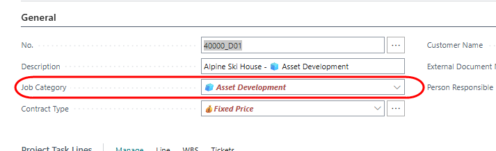

Go to the 'Braintree Project Accounting' tab. 

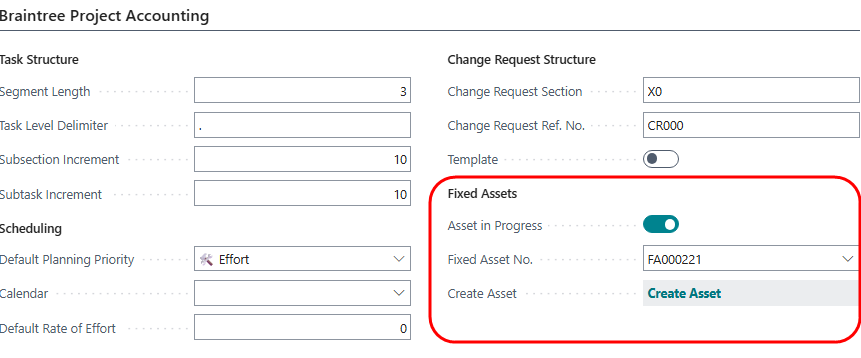

Turn on the field 'Asset in Progress'.  If the asset has already been created in the Fixed Asset register, you can select the asset number from the dropdown. 

## Create a new asset from project
If the asset has not already been created, click on 'Create Asset'. Click Yes on the dialog:
 
 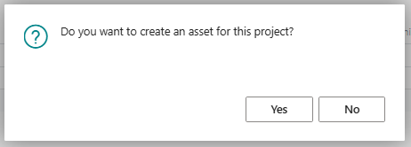

In the 'Create Fixed Asset' dialog, select an asset sub-class and posting group. Click OK:

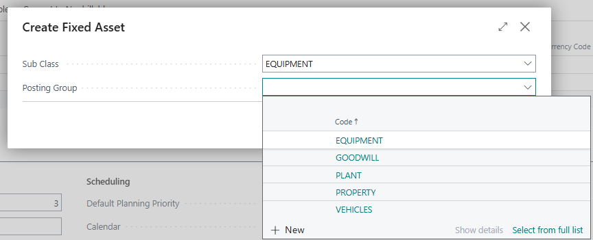

This will assign a new asset number, create the asset, and link it to the project.

## Record project costs
Using standard processes, such as resource time sheets, job journals or purchasing, assign costs to the tasks on your project.

## Capitalise costs to fixed asset
From the Braintree PPS role centre, select 'Finance Reports' -> 'Asset Capitalisation Worksheet'.

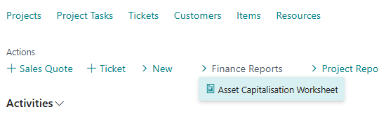

Alternatively, search for the worksheet.

The sheet opens, and sets the Posting Date to the last date of the prior month. This will filter the entries to show only entries accumulated on or before the date. Update the date if required.

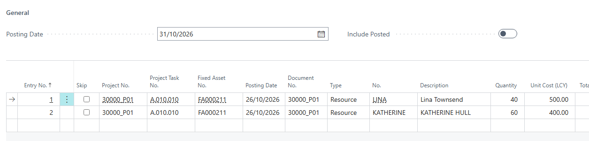

Click on 'Load New Entries':

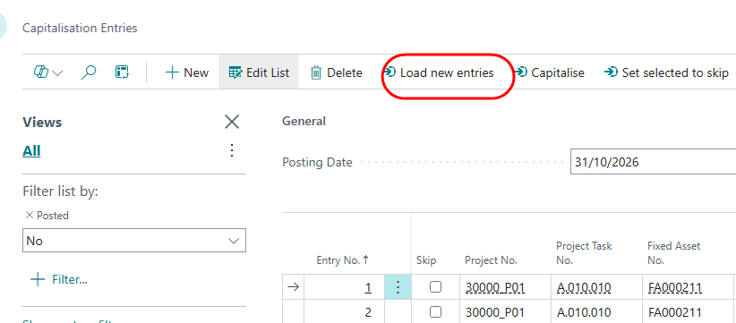

Any new transactions which have been posted since the last update will be inserted into the table.

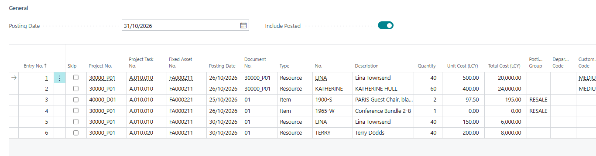

If you want to omit certain entries from capitalisation, turn on the field 'Skip'. You can do this individually, or you can select a number of records, and click on 'Set Selected to Skip':

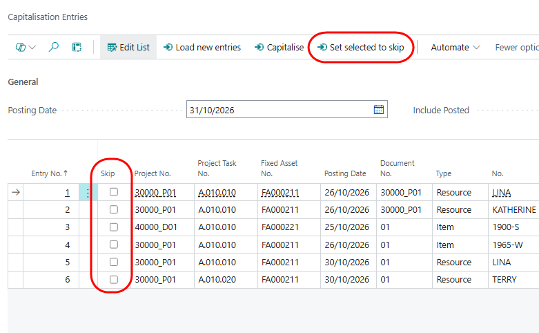.

Click on 'Capitalise'. Click on 'Yes':

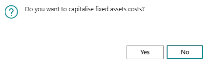

From the following dialog, clck on 'Post' to post the entries directly, or click on 'Open Batch' to review the entries before posting:

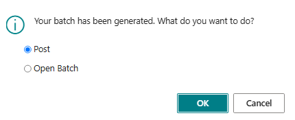

If you select 'Open Batch', the system will create a Fixed Asset G/L journal, containing one entry for each asset for which new entries exist. Balancing entries will also be loaded. After posting the batch, the capital amount will be added to the asset's acquisition cost.
